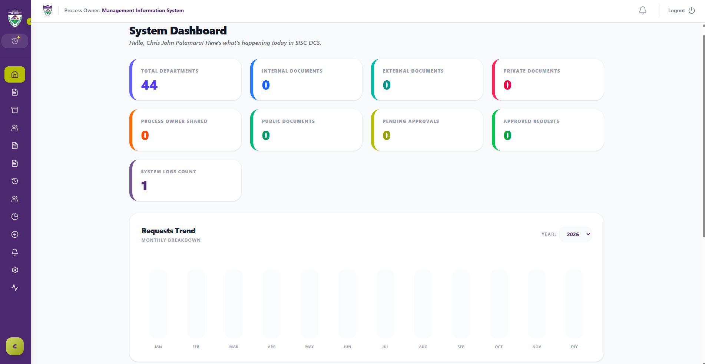
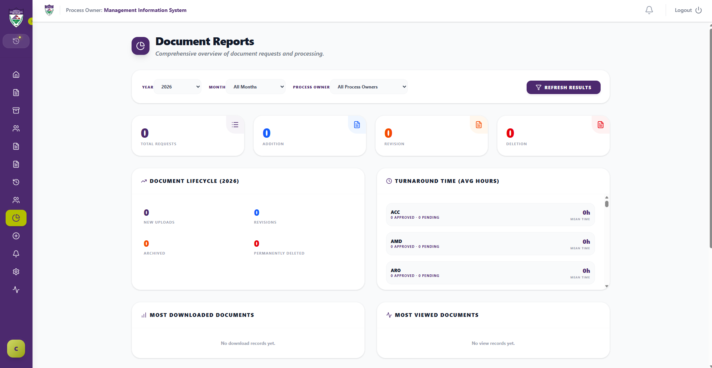
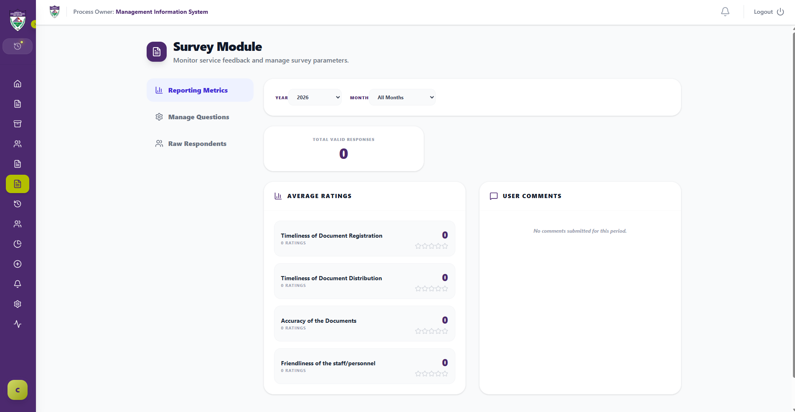

# 👋 Hi, I'm Chris John

💻 IT / Programmer  
🏫 Junior Programmer / Developer at Southville International School and Colleges  
🚀 Full Stack Developer (Laravel + React)  
📍 Las Piñas, Metro Manila, Philippines  

---

## 🧠 About Me

I am an IT professional working in Southville International School and Colleges, focused on building, maintaining, and improving web-based systems that support school operations and digital workflows.

I specialize in full-stack web development, backend systems, and API design. I also work with modern tooling, CI/CD pipelines, and automation to improve development efficiency.

---

## 🏢 Work Experience

### 🏫 Southville International School and Colleges
**Role:** Junior Programmer / Developer  

**Responsibilities:**
- Development and maintenance of internal systems
- Supporting academic and administrative platforms
- Database design and optimization
- System improvements and debugging
- Participation in digital transformation initiatives

---

## 🏢 Organizations / Affiliations

- 🏫 Southville International School and Colleges | MIS Team | Software Development Team
- 💻 GitHub Developer Community
- 🌐 Web Development Practitioner
- ⚙️ Continuous Learning in Modern Technologies

---

## 🚀 Tech Stack

### 🧑‍💻 Languages

---

### 🗄️ Databases

---

### ⚙️ Frameworks & Tools

---

### 🛠️ Development Tools

---

### 🌐 Deployment & Infrastructure

---

### ☁️ Cloud & Hosting

---

### 🤖 AI Tools

---

## 🧱 Architecture (Laravel + CI/CD)

Typical workflow I use:

- 🧑‍💻 Development (Local)
  - Laravel + Vite + MySQL
  - Feature branches (Git)

- 🔄 Version Control
  - Push to GitHub repository

- 🧪 CI (Continuous Integration)
  - Install dependencies (Composer + npm)
  - Run tests (PHPUnit)
  - Build frontend (Vite)

- 🚀 CD (Continuous Deployment)
  - Trigger on tag / main branch
  - Deploy to server (Apache/Nginx)
  - Run migrations
  - Restart queue workers

---

## 📂 Project Showcase

### 🔹 Google Users to BIOSTAR API  

**Description:**  
Developed an automated integration that synchronizes Google Workspace user accounts with the BIOSTAR access control system used for turnstiles. This ensures that user data (employees/students) remains consistent across systems without manual intervention.

**Key Features:**
- Automated user provisioning and synchronization
- Integration with Google APIs and BIOSTAR API
- Real-time or scheduled syncing
- Reduced manual data entry and errors

**Impact:**
- Improved access control accuracy
- Streamlined onboarding/offboarding process
- Enhanced operational efficiency

**Status:** ✅ Deployed  

##

### 🔹 SGEN IXL Insights  

**Description:**  
Built a reporting system that generates monthly performance insights for students using the IXL learning platform. The system aggregates and processes student data to provide meaningful analytics for academic monitoring.

**Key Features:**
- Automated monthly report generation
- Student performance tracking and analytics
- Data visualization for easier interpretation
- Exportable reports for administrative use

**Impact:**
- Helps SGEN Heads and Subject Area Heads monitor student progress effectively
- Supports data-driven academic decisions
- Saves time on Google Sheets report preparation

**Status:** ✅ Deployed  

##

### 🔹 Employee / Student Clearance System  

**Description:**  
Developed a web-based clearance management system to handle employee and student clearance processes efficiently. The system digitizes approvals and tracks clearance status across departments.

**Key Features:**
- Digital clearance workflow
- Multi-department approval tracking
- Real-time status monitoring
- User-friendly interface for staff and students

**Impact:**
- Eliminates paper-based processes
- Speeds up clearance processing time
- Improves transparency and accountability

**Status:** ✅ Deployed  

##

### 🔹 SISC Document Controller (ISO Documents)  

**Description:**  
Designed and implemented a centralized document management system for handling ISO-related documents within the institution. The system ensures proper version control, accessibility, and compliance with standards.

**Key Features:**
- Document version control and tracking
- Secure access and permission management
- Centralized repository for ISO documents
- Audit-ready document organization

**Impact:**
- Ensures compliance with ISO standards
- Improves document accessibility and organization
- Reduces risk of outdated or duplicate documents

**Status:** 🚀 For Deployment  

---
  
- ## 🚧 Ongoing Projects

### 🔹 SISC Talent Acquisition System  
**Description:**  
Currently developing a centralized recruitment and hiring management system for the institution. The platform aims to streamline the end-to-end hiring process—from job posting to applicant evaluation and onboarding.

**Key Features (Planned / In Progress):**
- Job posting and applicant tracking system (ATS)
- Candidate profile management
- Interview scheduling and evaluation workflows
- Role-based access for HR and department heads
- Document submission and tracking

**Goal:**
- Digitize and optimize recruitment processes
- Improve candidate tracking and communication
- Enhance hiring efficiency and decision-making

**Status:** 🚧 In Development  

##

### 🔹 Customized SGEN OpenSIS Reporting System  
**Description:**  
Enhancing and customizing reporting functionalities for OpenSIS to meet specific institutional requirements. The system focuses on generating tailored academic and administrative reports beyond the default capabilities.

**Key Features (Planned / In Progress):**
- Custom report builder for administrators
- Student academic performance reports
- Upload Student Grades
- Generate Student Grade Cards
- Data filtering and dynamic queries

**Goal:**
- Provide more flexible and detailed reporting tools
- Support data-driven decisions in academic management
- Reduce manual report generation workload

**Status:** 🚧 In Development  

### 🔹 ...and more projects ongoing...  

---

## 🖼️ Sample Screenshots of SISC Document Controller

---

## 🎯 Interests
- Web Application Development
- Backend Systems & APIs
- CI/CD & Automation
- System Architecture

---

## 💡 Created By:
> "Chris John Palamara | Junior Programmer"
